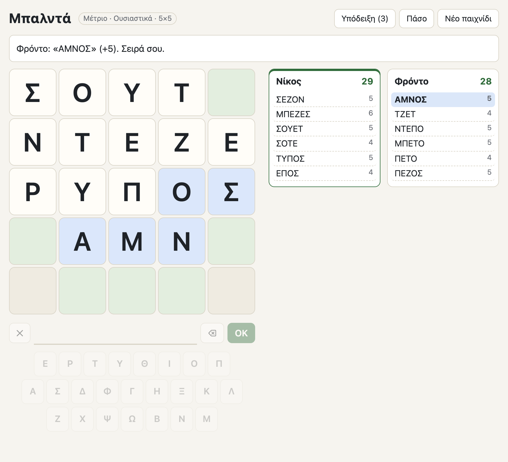
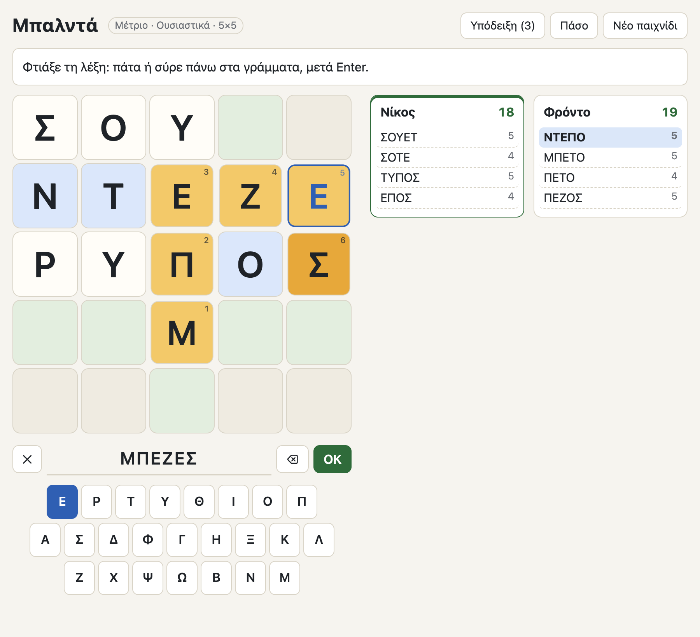
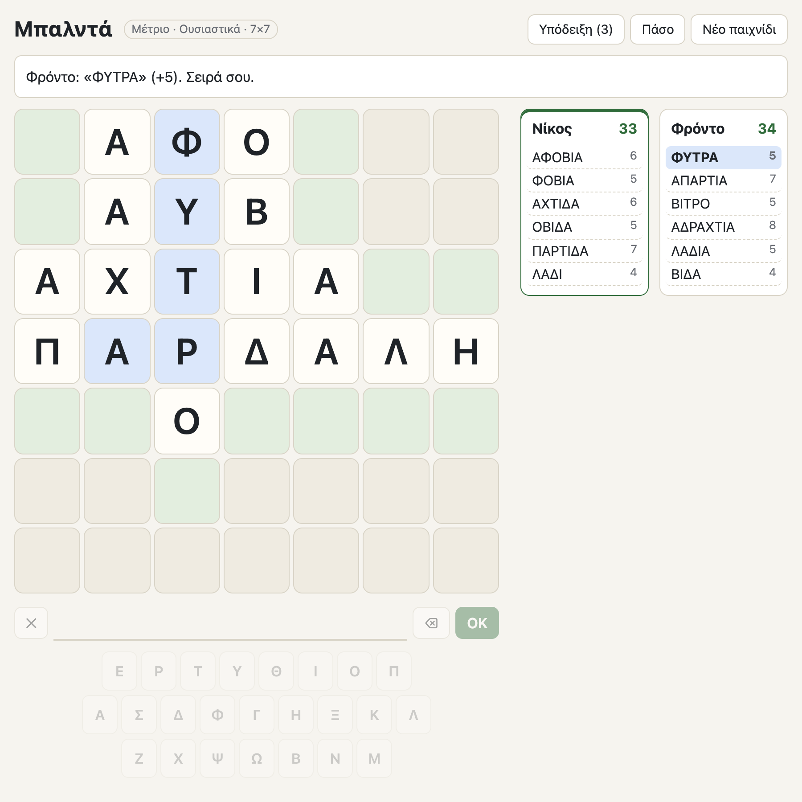
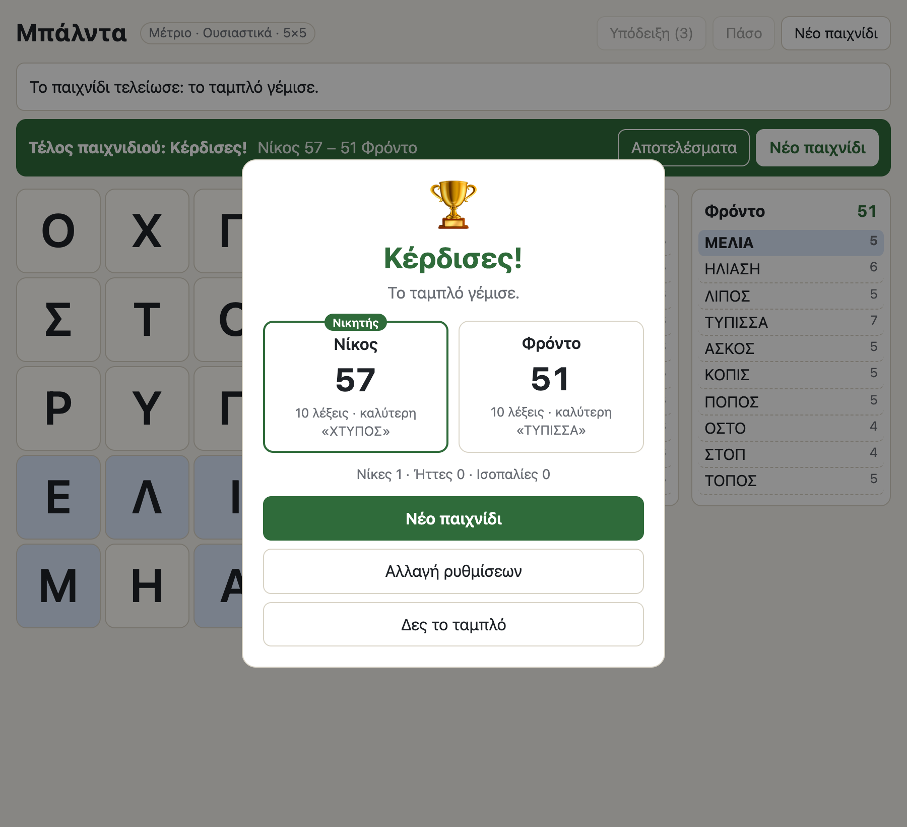
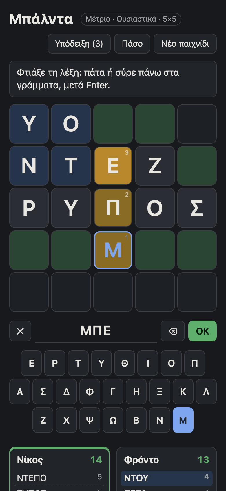
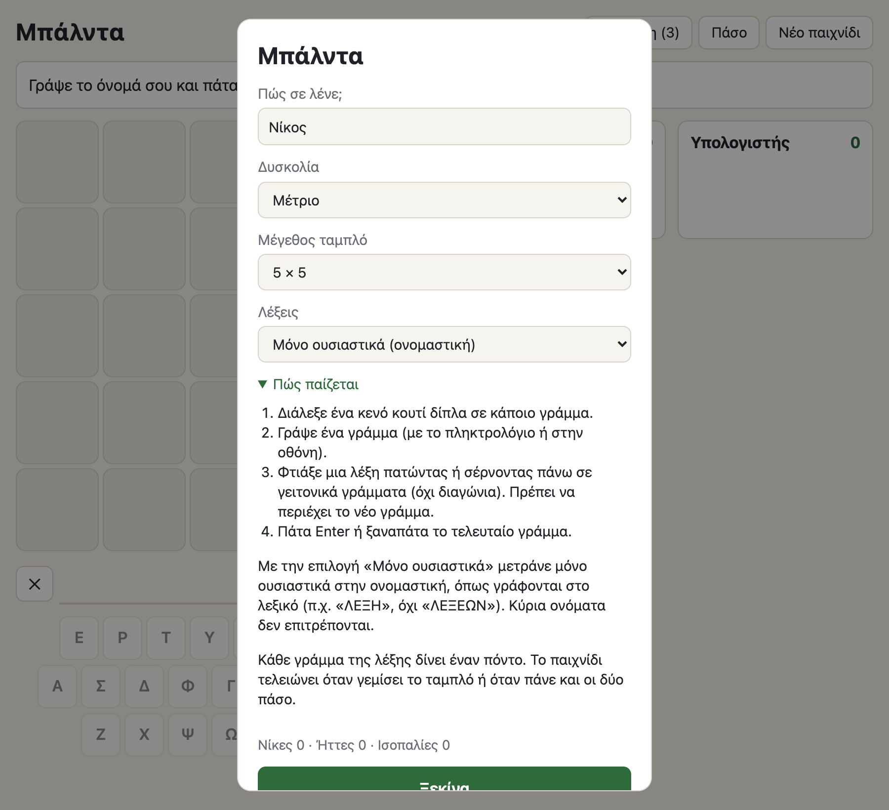

# Μπαλντά: Greek Balda

A Greek word game against the computer. Take turns adding one letter to the board, spell a
word through it, and score a point for every letter.



Live version: https://tsaklidis.gr/balda/

## Features

- **Nouns only by default:** about 47,000 Greek nouns in the nominative, so no strange word forms. A full word list is one click away.
- **Three board sizes:** 5×5, 6×6 or 7×7. Bigger boards mean longer games and longer words.
- **Fast computer opponent** with three difficulty levels: Εύκολο, Μέτριο, Δύσκολο.
- **Hints:** three per game. A hint shows where to put a letter and which one, but not the word.
- **Typing:** use the on-screen Greek keyboard, or your own keyboard with a Greek or Latin layout.
- **Building words:** click the letters one by one, or drag across them.
- **Phones and dark mode** are supported.
- **No install, no server code, no dependencies:** plain HTML, CSS and JavaScript.

## Play locally

No server and no installation are needed. Download the repository and open `index.html` in
your browser, for example by double-clicking it:

```bash
git clone https://github.com/tsaklidis/greek-balda.git
```

```bash
open greek-balda/index.html
```

(`open` is for macOS; on Linux use `xdg-open`, on Windows `start`, or just double-click the file.)

This works because the game never fetches files with code. Both word lists are JavaScript
files loaded with `<script>` tags, which browsers also allow for pages opened from disk.
Your name, settings and win/loss record are saved in the browser.

A local server is optional. You only need one if you want to try the game exactly as a
website serves it:

```bash
python3 -m http.server 8123
```

Then go to http://localhost:8123.

### Hosting it on a website

Copy these files to any static web host. No PHP or other server-side code is needed:

```
index.html
css/style.css
js/balda.js
js/nouns.js
js/dictionary.js
```

`data/`, `tools/` and `screenshots/` are only for development. The `?v=2` after the script and
stylesheet links in `index.html` (and after `js/dictionary.js` in `js/balda.js`) makes
browsers download fresh copies. Increase it whenever you change those files, so visitors
don't keep using old cached versions.

## How to play



1. Enter your name and choose a difficulty, a board size and a word list.
2. Click an empty cell next to a letter. Cells you can use are tinted green.
3. Type a letter. Your new letter appears in blue.
4. Spell a word through neighbouring letters: up, down, left or right, not diagonally. The word must include your new letter, and the letters are numbered as you go.
5. Press `Enter`, click **OK**, or click the last letter again.

The computer then plays its word. The most recent word is highlighted in blue, both on the
board and in the score lists. The game starts with a word across the middle row, as long as
the board is wide: 5, 6 or 7 letters.

### Rules

- Words need at least 3 letters, and each word can be played only once per game.
- Each letter of your word scores 1 point.
- The game ends when the board is full or when both players pass in a row. The higher score wins.
- When the game ends, a results window shows the winner, the final score and each player's best word. From there you can start a new game with the same settings, change the settings first, or close the window to look at the final board. A green banner then keeps the result and a «Νέο παιχνίδι» button on screen.
- Filling the board takes 10 words each on 5×5, 15 on 6×6 and 21 on 7×7, so without passes both players get the same number of turns.

<p>
  
  
</p>

### Controls

| Action | Mouse / touch | Keyboard |
|---|---|---|
| Choose a cell | Click an empty green cell | |
| Type the letter | On-screen keys | Any Greek letter, or its Latin key (`s` → Σ, `u` → Θ, `v` → Ω …) |
| Build the word | Click or drag over letters | |
| Remove the last letter | ⌫ button | `Backspace` |
| Cancel the move | ✕ button | `Esc` |
| Submit | **OK**, or click the last letter again | `Enter` |

<p>
  
  
</p>

## Word lists

You choose the word list at the start of each game:

- **Μόνο ουσιαστικά** (nouns only, the default). Uses `js/nouns.js`, about 260 KB.
  - About 47,000 nouns in the nominative, as they appear in a dictionary: «ΛΕΞΗ», not «ΛΕΞΕΩΝ».
  - Excluded: proper nouns, inflected forms, polytonic spellings, and words whose every meaning is archaic, katharevousa or dialect.
  - You may play any of them. The computer and the hints only use the about 31,000 that also appear in the spell-checker list, so the computer doesn't win with obscure words.
- **Όλες οι λέξεις** (all words). Uses `js/dictionary.js`, about 1.2 MB, which loads only when you choose it.
  - Every word form in the spell-checker list `data/dic_gr_lowercase.js`, about 383,000 words, proper nouns excluded.

Words are compared without accents, so «ΗΛΙΟΣ» matches «ήλιος».

## Project structure

```
index.html                  page and start dialog
css/style.css               layout, light and dark themes
js/balda.js                 game rules, computer opponent, user interface
js/nouns.js                 nouns word list (generated)
js/dictionary.js            full word list (generated)
data/dic_gr_lowercase.js    source spell-checker word list (Greek, ~408k forms)
data/dic_gr_uppercase.js    the original upper-case version of that list
data/dic_ru.js              the original Russian word list (not used by the game)
data/el_wiktionary_nouns.jsonl.gz  Greek Wiktionary nouns: tags, definitions, inflections
tools/build_dictionary.py   builds js/nouns.js and js/dictionary.js
tools/capture_screenshots.mjs  regenerates the images in screenshots/
```

## Development

### Rebuilding the word lists

Both lists are built from the files in `data/`:

```bash
python3 tools/build_dictionary.py
```

The nouns come from the Greek Wiktionary noun export, downloaded from kaikki.org on
2026-11-23. The original file is 185 MB and kaikki.org has marked it for removal, so the
repository keeps a compact copy, `data/el_wiktionary_nouns.jsonl.gz` (~4 MB). It has all
133,811 noun entries with their tags, definitions and links to inflected forms. To build from
a newer export instead, pass its path (`.jsonl` or `.jsonl.gz`):

```bash
python3 tools/build_dictionary.py kaikki.org-dictionary-Greek-by-pos-noun.jsonl
```

Both lists are stored sorted and
front-coded: each word keeps only the letters it doesn't share with the previous word. This
keeps the files small, and the game decodes them when it loads.

### Updating the screenshots

With Google Chrome installed, run from the repository folder:

```bash
node tools/capture_screenshots.mjs screenshots "file://$PWD/index.html"
```

The script plays reproducible games in headless Chrome and saves the images to `screenshots/`.
Without arguments it uses http://localhost:8123/, if you prefer to run a local server.

## Credits

The noun list is derived from [Wiktionary](https://el.wiktionary.org) (extracted by
[kaikki.org](https://kaikki.org/elwiktionary/) / wiktextract) and is available under
[CC BY-SA 4.0](https://creativecommons.org/licenses/by-sa/4.0/).
